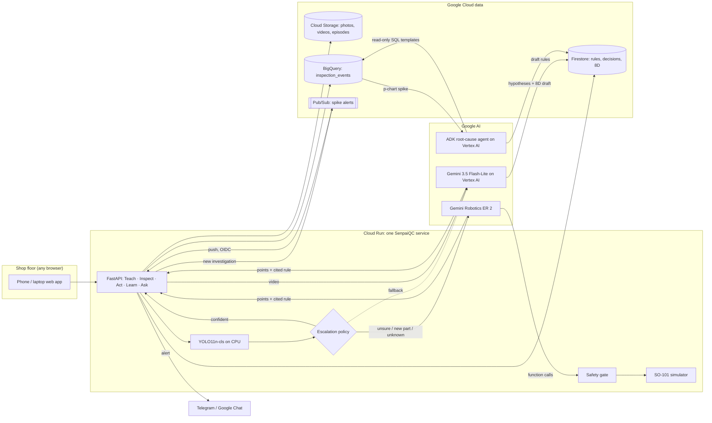

<div align="center">

# SenpaiQC

**An expert-taught inspection cell: a senior inspector teaches it once on video, and every shift inspects like them.**

Built on Gemini Robotics ER 2, Gemini on Vertex AI, Agent Development Kit, Cloud Run, BigQuery, Firestore and Pub/Sub.

[](https://senpaiqc-568251697792.us-central1.run.app)


[Live demo](https://senpaiqc-568251697792.us-central1.run.app) ·
[Submission narrative](docs/pitch-narrative.md) ·
[Submission deck](docs/SenpaiQC-submission.pptx) ·
[Architecture & guardrails](docs/architecture.md) ·
[Demo video script](docs/demo-video-script.md) ·
[Teach video script](docs/teach-video-IMP-200-script.md)

*Google Cloud AI Builder Cup 2026 · Manufacturing: Intelligent Operations & Industrial Efficiency*

</div>

---

## The problem

Tier-2 and Tier-3 suppliers (metal casting, stamping, moulding) in Indonesia, Thailand, Vietnam
and Malaysia feed automotive and electronics supply chains; one example is the metal-casting
cluster of Ceper, Klaten (Central Java). On their floors today:

1. **Quality depends on who is on shift.** Visual inspection is manual; a tired or new inspector
   lets defects through or scraps good parts.
2. **The best judgment walks out the door.** A senior inspector knows which porosity is
   acceptable, but that knowledge is tacit and leaves when they retire.
3. **Escapes are expensive.** A defect at the customer means sorting, chargebacks and an 8D
   report that takes a QC engineer days to compile.
4. **Classic machine vision does not fit SMEs.** Thousands of labelled images per part number
   plus an integrator, while SMEs launch new part numbers often.
5. **The floor is multilingual.** Operators speak Bahasa Indonesia, Thai or Vietnamese; customers
   and auditors want English.

## The solution

SenpaiQC closes the quality loop, **Teach → Inspect → Act → Learn → Improve**, and uses AI only
where judgment is needed:

| Job | Who does it | Why |
|---|---|---|
| Turn an expert video into rules | **Gemini on Vertex AI** (video read from Cloud Storage) | Captures tacit knowledge in the expert's own words |
| Screen every part | **YOLO11n-cls** on CPU | Fast and nearly free; 99% of parts in our test |
| Judge the hard cases | **Gemini Robotics ER 2**, fallback **Gemini 3.5 Flash-Lite on Vertex AI** | Points at the defect and cites the expert's rule; no labelled data |
| Flag a defect spike | **Plain statistics** (p-chart, 3σ) | Deterministic and auditable |
| Tell the QC team | **Pub/Sub → Telegram / Google Chat** | Delivered with retries; never blocks the line |
| Explain the spike, draft the 8D | **ADK agent** with read-only BigQuery tools | Reasons over data, never writes SQL |
| Final say on scrap and rules | **A person** | Always |

## Screenshots

| Teach: rules from the expert's video | Inspect: Gemini circles the defect and cites the rule |
|---|---|
|  |  |
| **Act:** simulated SO-101 cell, 3D replay | **Learn:** the ADK agent names the root cause |
|  |  |

## Features

| Who | Feature | What they get |
|---|---|---|
| Senior inspector | **Teach from video** | Narrated video (up to 10 min / 500 MB, signed upload to Cloud Storage) → one rule card per defect: look, location, how to inspect, accept limit, severity, fix, video timestamp. Drafts never reach the line until approved |
| Line operator | **Inspect** | Phone photo or sample part → pass / rework / scrap banner, defect circled, rationale and cited rule. Scrap needs a second tap |
| Line operator | **Rework guide** | Tick-box steps from the cited rule in **English, Bahasa Indonesia, Thai or Vietnamese** |
| Supervisor | **Needs confirmation** | Every scrap, unknown defect and invalid model result waits for a person; overrides are logged |
| QC engineer | **Quality analytics** | p-chart per defect and shift, Pareto, live cost and latency, evaluation results |
| QC engineer | **Spike alerts** | A new spike goes through Pub/Sub to Telegram or Google Chat, with retries and a test button |
| QC engineer | **Root cause + 8D** | ADK agent ranks machine, mould, lot and combination hypotheses; D1–D8 pre-filled; `.docx` export for Word / Google Docs |
| Everyone | **Ask SenpaiQC** | Answers only from the plant's records, always with citations, or "not found in records" |
| Plant manager | **Overview** | Role-aware "what needs you now", parts inspected, share sent to Gemini, cost per 1,000 parts |
| Optional | **Robot cell** | Gemini plans `pick → present_to_camera → place_in_bin` by function calling; a safety gate checks every call; disagreement goes to a hold bin |
| Platform | **Guardrails** | Schema-validated model output with retry, model circuit breaker, per-user and daily AI budgets, CSP, secrets only in Secret Manager |

## Architecture



| Step | What happens | Output |
|---|---|---|
| **1. Teach** | Gemini returns rule cards under a strict response schema (Pydantic, retried); the expert edits and approves | Approved rule cards |
| **2. Inspect** | YOLO confidence ≥ 0.85 on a known class decides; otherwise (0.40–0.85, unknown class, or a part with < 50 labels) Gemini gets the photo and the approved rules, points at each defect and cites a rule | Decision, points, cited rule, latency, cost |
| **3. Guardrails** | Plain code: an uncited defect can never pass; scrap, uncited or invalid results go to a person | `needs_human_confirm` |
| **4. Act** | Rework steps from the cited rule in the operator's language, or a robot plan through the safety gate | Operator guide / robot episode |
| **5. Record** | Every final decision is written to BigQuery (flagged ones after the human confirm) | `inspection_events` row |
| **6. Learn** | p-chart with limits from the first 10 days; a new investigation goes through Pub/Sub to the QC chat; the ADK agent may only call named SQL templates, `get_cards`, `get_process_context` and `draft_8d` | Alert, hypotheses, 8D draft |
| **7. Improve** | Confirmed Gemini decisions are exported as Ultralytics labels; YOLO retrains | Fewer escalations, lower cost |

The backend is **hexagonal**: domain code imports no Google SDK, so models and stores are swapped
through ports (Gemini API key or Vertex AI, Firestore or SQLite, an offline mode with no key).

**Google Cloud services (11):** Cloud Run · Cloud Build · Artifact Registry · Vertex AI ·
Gemini API · Firestore · Cloud Storage · BigQuery · Pub/Sub · Secret Manager · IAM Credentials.

## Results

**Held-out golden set:** 200 images (100 good, 100 defective) from the test split, never used for
training, real YOLO + Gemini, 2026-10-17. Source: [`eval/results/summary.json`](eval/results/summary.json).

| Metric | Result |
|---|---|
| Defect recall / false reject rate | **99% / 0%** |
| Decided on CPU by YOLO (fast path) | **99%** of parts, p95 **171 ms** |
| Escalated to Gemini Robotics ER 2 | 1% (2 of 200; the one missed defect came from this path) |
| Gemini cost per 1,000 parts | **$0.07** |

**Live service:** Cloud Run `us-central1`, Gemini 3.5 Flash-Lite on Vertex AI, 2026-10-18.

| Action | Result | Time | Gemini cost |
|---|---|---|---|
| Teach video (1 min 58 s) → rule cards | 4 of 4 defects, 24 of 24 fields matching the narration | 9.4 s | $0.005 |
| Easy part, YOLO fast path | Correct decision | about 1 s | $0 |
| Hard part, escalated to Gemini | Rework, approved rule cited | 1.4–3.3 s | $0.001–0.002 |
| Root cause on the planted scenario (synthetic) | Mould MD-04 + lot LOT-2409C, 8D drafted | about 30 s | $0.027 |
| Ask SenpaiQC, in Bahasa Indonesia | Correct limit, rule cited | 1.3 s | $0.0008 |
| Spike alert through Pub/Sub | Delivered to Telegram, retried on failure | seconds | $0 |

## Quick start

**Run locally (no keys needed):**

```bash
python data/generate_process.py
```
```bash
python server/api/seed.py
```
```bash
python -m uvicorn main:app --app-dir server/api --port 8080
```
```bash
npm --prefix client install
```
```bash
npm --prefix client run dev
```

Open http://localhost:5173 and sign in with the local demo token `senpaiqc-demo` (Cloud Run
refuses to start with it). Copy `.env.example` to `.env`; it points the fast path at the shipped
YOLO weights in `models/best.pt`. Without `GEMINI_API_KEY` or `USE_VERTEX=true` the app runs in
**offline mode**: escalations only propose a candidate, every result waits for a person, and the
banner says no AI judgment was made.

**Tests and evaluation:**

```bash
python -m pytest server/api/tests -q
```
```bash
python eval/run_all.py
```

`run_all.py` measures recall, false-reject rate, escalation rate (before and after
`--weights-after`), p95 latency per path, cost per 1,000 parts, time to the 8D draft and whether
the root cause matches `data/planted_cause.json`. The full training pipeline (dataset prep, YOLO
training, retraining on confirmed labels) is in [`eval/`](eval).

## Deploy on Google Cloud

One Cloud Run service builds the web app and serves it next to the API. Gemini runs on Vertex AI
with the service account; secrets live only in Secret Manager.

```bash
PROJECT=your-project ./infra/push_secrets.sh
```
```bash
PROJECT=your-project MAX_INSTANCES=1 ./infra/deploy_cloudrun.sh
```

- **Region:** `us-central1` by default (lowest Cloud Run price tier). Storage, Firestore (a named
  database) and BigQuery get region-specific names, so `REGION=... SUFFIX=...` can run side by side.
- **Secrets:** `push_secrets.sh` pushes `GEMINI_API_KEY`, `DEMO_TOKEN` and the optional
  `TELEGRAM_BOT_TOKEN`, `TELEGRAM_CHAT_ID`, `GOOGLE_CHAT_WEBHOOK` from `.env`. Values are never
  printed, and a random judge token is generated if the local default is still set.
- **Alerts:** the script creates the `senpaiqc-alerts` topic and an OIDC push subscription back to
  `/api/alerts/push`.
- **Judges' token:** `gcloud secrets versions access latest --secret SENPAIQC_DEMO_TOKEN --project your-project`.
- **Before a demo recording:** `python server/api/demo_reset.py` (same `BACKEND` / `GCP_PROJECT` /
  `FIRESTORE_DATABASE`) closes open investigations so the next scan sends a fresh alert; nothing is deleted.
- **Windows:** run the scripts through Git Bash:
  `$env:PROJECT="your-project"; & "C:\Program Files\Git\bin\bash.exe" ./infra/deploy_cloudrun.sh`.
- **Alternative:** `infra/deploy.sh` deploys a private ADK agent service plus Firebase Hosting with
  Firebase Auth.

Both scripts create billable resources; read them first.

## Limitations

| Limitation | Why it matters | Next step |
|---|---|---|
| The Gemini path is measured on only 2 golden-set parts | Too few to claim Gemini accuracy | A harder test set (blurred, angled, new parts) |
| The single miss came from Gemini passing a defective part | "Escalated + pass" is auto-accepted today | Route every escalated pass to a person until citation accuracy is measured |
| Rule-citation accuracy and the escalation drop after retraining are not yet measured | "Explainable" and "gets cheaper" are designed, not proven | `eval/sample_citations.py`, `run_all.py --weights-after` |
| The teach video was recorded by our team over slides with the same text, not by a plant inspector | Accept limits are illustrative | Record one inspector at a real plant |
| Root-cause process data is synthetic, with one planted cause | Proves the method, not field performance | Run on one real plant's inspection log |
| One part type, top view, grayscale; possibly augmented near-duplicates | Scores may be optimistic | Validate on local SME photos |
| The robot is a scripted kinematic simulator; the second look is a digital zoom | Orchestration and safety, not manipulation | LeRobot SO-101 simulation or a real arm on the same port |
| ER 2 is not on Vertex AI and needs a Gemini API key with credit | Golden-set numbers use ER 2; production uses the fallback | The UI and audit trail record which model judged each part |
| Hosted in `us-central1`, models on the Vertex AI `global` endpoint | Plant data is processed outside Indonesia | `REGION=asia-southeast2 SUFFIX=id` for data residency |
| Only rework steps and Ask are multilingual; the interface is English | Operators read menus in English | Translate the operator screens |
| Demo login is a shared token; one instance with a daily AI budget | Not multi-tenant, not production auth | Firebase Auth variant in `infra/deploy.sh` |

## What is real, what is synthetic

| Piece | Status |
|---|---|
| Part images | Public casting dataset (Kaggle, pump impellers); see [`docs/licences.md`](docs/licences.md) |
| Process history (30 days, machines, moulds, lots) | **Synthetic**, from `data/generate_process.py`, one planted cause; rows have `line_id` starting `SYN-` and zero latency and cost |
| Rule cards | Seed cards (`approved_by: demo-seed`) plus `-v2` drafts that Gemini made from our narrated [teach video](docs/video/teach-video-IMP-200.mp4) |
| Metrics | Only from `eval/results/summary.json` and logged calls on the live service |
| Robot | Scripted kinematic SO-101 controller; episodes are JSON, replayed in the app |

## Repository layout

```
client/            React + Vite web app (mobile-first; one-tap inspect on phones, sidebar on laptops)
server/api/        FastAPI service, hexagonal:
  domain/          pure models and rules: escalation policy, SPC, robot safety gate (no Google SDK)
  ports/           interfaces the slices depend on
  adapters/        Gemini ER 2 / Vertex AI, YOLO, ADK agent, Firestore / GCS / BigQuery / Pub/Sub, alert channels, offline, robot sim
  slices/          teach · inspect · act · learn · ask · alerts (vertical slices: router + service)
  guards.py        AI rate limits, daily budget and security headers
  tests/           pytest suite (offline adapters, no keys needed)
server/agent/      ADK root-cause agent as its own Cloud Run service (+ `adk web server/agent`)
models/            shipped YOLO fast-path weights and label counts
data/              synthetic process generator, dataset prep, seed cards, golden-set manifest, samples
eval/              run_all.py (all metrics), YOLO training, citation review, results/
infra/             Dockerfiles, Cloud Run deploy, Secret Manager push, BigQuery DDL and setup, Firestore rules
docs/              submission narrative and deck, architecture, demo and teach video scripts, licences, screenshots
```

<div align="center">

Built by **Simon Surya Keban** for the Google Cloud AI Builder Cup 2026.

</div>
