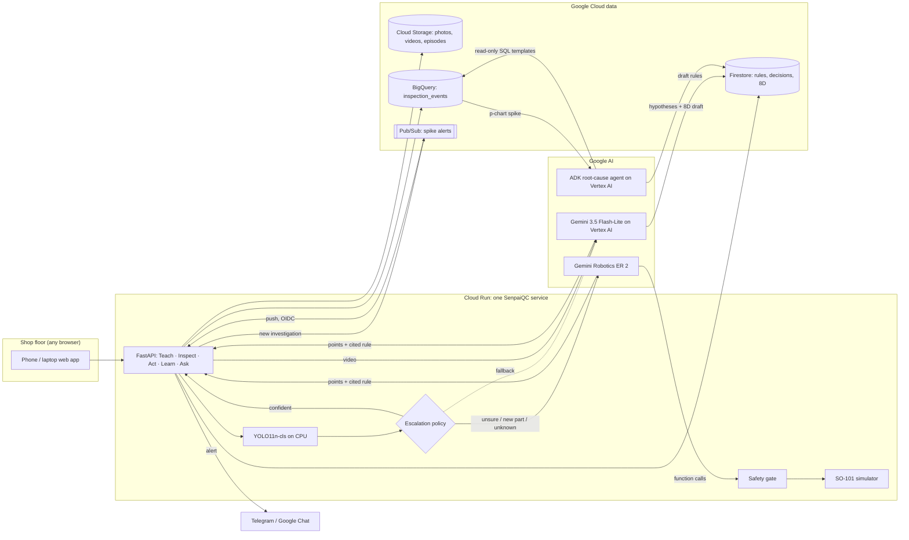

# SenpaiQC: an expert-taught inspection and rework cell

A senior inspector teaches it once on video. YOLO screens every part. Unclear, unknown or new-part
cases escalate to **Gemini Robotics ER 2** (or Gemini on **Vertex AI** as fallback), which points
at the defect, cites the expert's rule and decides **pass / rework / scrap**. The decision drives
rework steps in the operator's language, or a simulated SO-101 arm. Every decision goes to
**BigQuery**, where a p-chart flags spikes, and an **ADK** agent finds the root cause and drafts
the 8D report. A person stays in charge of every scrap and every rule.

Built for the Manufacturing theme (Intelligent Operations & Industrial Efficiency) of the Google
Cloud AI Builder Cup 2026.

- **Live app:** https://senpaiqc-568251697792.us-central1.run.app (sign-in token in the submission notes)
- **Submission narrative** (follows the AI Builder Cup template: idea, features, flow, architecture, cost, benchmarks, roadmap): [`docs/pitch-narrative.md`](docs/pitch-narrative.md)
- **Architecture and guardrails:** [`docs/architecture.md`](docs/architecture.md)

## Problem statement

Tier-2 and Tier-3 component suppliers (metal casting, stamping, moulding) in Indonesia, Thailand,
Vietnam and Malaysia feed automotive and electronics supply chains. One example is the
metal-casting cluster of Ceper, Klaten (Central Java). On their floors today:

1. **Quality depends on who is on shift.** Visual inspection is manual. A tired or new inspector
   lets defects through, or scraps good parts.
2. **The best judgment walks out the door.** A senior inspector knows which porosity is acceptable
   and which is not, but that knowledge is tacit, never written down, and leaves when they retire.
3. **Escapes are expensive.** A defect that reaches the customer brings sorting, chargebacks and an
   8D report, and compiling the evidence for an 8D takes a QC engineer days.
4. **Classic machine vision does not fit SMEs.** It needs thousands of labelled images per part
   number plus an integrator, and SMEs launch new part numbers often.
5. **The floor is multilingual.** Operators speak Bahasa Indonesia, Thai or Vietnamese; customers
   and auditors want English.

SenpaiQC answers this with a closed quality loop, **Teach → Inspect → Act → Learn → Improve**, that
uses AI only where judgment is needed and plain code everywhere else:

| Job | Who does it | Why |
|---|---|---|
| Screen every part | **YOLO11n-cls** on CPU | Fast and nearly free; 99% of parts in our test |
| Judge the hard cases | **Gemini Robotics ER 2**, fallback **Gemini 3.5 Flash-Lite on Vertex AI** | Points at the defect and cites the expert's rule; no labelled data needed |
| Turn an expert video into rules | **Gemini on Vertex AI** (video read straight from Cloud Storage) | Captures tacit knowledge in the expert's own words |
| Flag a defect spike | **Plain statistics** (p-chart, 3σ) | Deterministic and auditable |
| Explain the spike, draft the 8D | **ADK agent** with read-only BigQuery tools | Reasons over data, never writes free-form SQL |
| Final say on scrap and rules | **A person** | Always |

## Features

| Who | Area | What they get |
|---|---|---|
| Senior inspector | **Teach** | Upload or record a narrated video (up to 10 min / 500 MB, sent straight to Cloud Storage). Gemini drafts one rule card per defect: look, location, accept limit, severity, fix, how to inspect, video timestamp. The expert edits and approves; drafts are never used on the line |
| Line operator | **Inspect** | Phone photo or sample part → large pass / rework / scrap banner with the defect circled. "Why" shows the rationale and the expert rule used. Scrap needs a second tap |
| Line operator | **Act** | Rework steps with tick boxes in **English, Bahasa Indonesia, Thai or Vietnamese**, generated from the cited rule and cached per language |
| Inspector / supervisor | **Confirm** | Queue of every scrap, every defect with no matching rule and every invalid model result. Overrides are logged; the person's call is what the quality record keeps |
| QC engineer | **Learn** | p-chart per defect and shift; a point above 3σ opens an investigation and alerts the QC team on Telegram or Google Chat (through Pub/Sub, with retries). "Find root cause" runs the ADK agent over machines, moulds, lots and their combinations. 8D editor (D1–D8), pre-filled by the agent, with `.docx` export for Word / Google Docs |
| Everyone | **Ask SenpaiQC** | Questions in the user's language, answered only from the plant's records (rules, investigations, 8D, statistics, evaluation), always with citations, or "not found in records" |
| Plant manager | **Overview** | Role-aware "what needs you now", parts inspected, share sent to Gemini, cost per 1,000 parts, open spikes |
| Optional | **Robot cell** | ER 2 plans `pick → present_to_camera → place_in_bin → stop` by function calling. A safety gate checks every call; a second look at the angle the rule describes; disagreement sends the part to a hold bin. Replay in 3D (Three.js) with a 2D fallback |
| Platform | **Guardrails** | Human confirm for scrap and unknown defects, schema-validated model output with retry, circuit breaker between models, per-user and daily AI budgets, CSP and security headers, secrets only in Secret Manager |

## Workflow and architecture



| Step | Input | What happens | Output |
|---|---|---|---|
| **1. Teach** | Expert's narrated video | Gemini returns rule cards under a strict response schema, validated with Pydantic and retried. The expert edits and approves | Approved rule cards (Firestore) |
| **2. Inspect** | Part photo + line context (machine, mould, lot) | YOLO scores it. Confidence ≥ 0.85 on a known class: YOLO decides. Otherwise (0.40–0.85, unknown class, or a part with fewer than 50 labels) Gemini gets the photo and the approved rules, points at each defect and cites a rule | Decision, defect points, cited rule, rationale, latency, cost |
| **3. Guardrails** | The decision | Plain code: an uncited defect can never pass; scrap, uncited or schema-invalid results go to a person | `needs_human_confirm` flag |
| **4. Act** | Confirmed decision | Rework steps from the cited rule in the operator's language, or a robot plan through the safety gate | Operator guide / robot episode |
| **5. Record** | Every final decision | Written to BigQuery (flagged ones only after the human confirm) | `inspection_events` row |
| **6. Learn** | BigQuery events | p-chart per defect with limits from the first 10 days, so a spike cannot widen its own limits. The ADK agent may only call named SQL templates with bound parameters, `get_cards`, `get_process_context` and `draft_8d`. A new investigation is published to Pub/Sub, which pushes it back to the service for delivery to Telegram / Google Chat | Investigation, alert, ranked hypotheses, 8D draft |
| **7. Improve** | Confirmed Gemini decisions | Exported as Ultralytics labels; YOLO retrains on the hard cases | Fewer escalations, lower cost |

The backend is hexagonal: domain code imports no Google SDK, so models and stores are swapped
through ports (Gemini API key or Vertex AI, Firestore or SQLite, offline mode without any key).

## Measured results

Held-out golden set of 200 images (never used for training), real YOLO + Gemini, 2026-10-17.
Source: [`eval/results/summary.json`](eval/results/summary.json).

| Metric | Result |
|---|---|
| Defect recall / false reject rate | 99% / 0% |
| Decided on CPU by YOLO (fast path) | 99% of parts, p95 171 ms |
| Escalated to Gemini Robotics ER 2 | 1% (2 of 200; the one missed defect came from this path) |
| Gemini cost per 1,000 parts | $0.07 |
| Root cause on the planted scenario (synthetic data) | ADK agent named mould MD-04 + lot LOT-2409C |

On the live service (Cloud Run `us-central1`, Gemini 3.5 Flash-Lite on Vertex AI, 2026-10-18):

| Action | Time | Gemini cost |
|---|---|---|
| Easy part, YOLO fast path | about 1 s | $0 |
| Hard part, escalated to Gemini | 1.4–3.3 s | $0.001–0.002 |
| Ask SenpaiQC, in Bahasa Indonesia | 1.3 s | $0.0008 |
| Root cause + 8D draft (12–13 read-only tool calls) | about 30 s | $0.027 |

## Limitations

| Limitation | Why it matters | What we do about it |
|---|---|---|
| **The Gemini path is measured on only 2 golden-set parts**, because the set was easy for YOLO | Too few to claim Gemini accuracy | Next: a harder test set (blurred, angled, new parts) |
| **The single miss came from Gemini passing a defective part** | An "escalated + pass" is currently auto-accepted | Route every escalated pass to a person until citation accuracy is measured |
| **Rule-citation accuracy and the teacher–student escalation drop are not yet measured** | "Explainable" and "gets cheaper" are designed, not proven | `eval/sample_citations.py` and `run_all.py --weights-after` measure them |
| **The teach video was recorded by our team**, over slides showing the same text (it drafted 4 of 4 cards, 24 of 24 fields right, in 9.4 s); not yet by a plant inspector | Accept limits are illustrative, not a plant standard | Record one inspector at a real plant; have a QC engineer correct one card |
| **Process data for root cause is synthetic**, with one planted cause | Proves the method, not field performance | Run on one real plant's inspection log |
| **Dataset:** one part type, top view, grayscale, possibly augmented near-duplicates | Scores may be optimistic | Validate on local SME photos |
| **Robot is a scripted kinematic simulator**; the second look is a digital zoom | Demonstrates orchestration and safety, not manipulation | Plug a LeRobot SO-101 simulation or a real arm into the same port |
| **ER 2 is not on Vertex AI** and needs a Gemini API key with credit; otherwise hard parts go to Flash-Lite | Golden-set numbers use ER 2; production numbers use the fallback | The UI and audit trail record which model judged each part |
| **Hosted in `us-central1`, models on the Vertex AI `global` endpoint** (for cost) | Plant data is processed outside Indonesia | Redeploy with `REGION=asia-southeast2 SUFFIX=id` for data residency |
| **Only rework steps and Ask are multilingual**; the interface itself is English | Operators read menus in English | Operator screens can be translated next |
| **Demo login is a shared token**; one instance with a daily AI budget | Not multi-tenant, not production auth | `infra/deploy.sh` variant uses Firebase Auth |

## What is real, what is synthetic

| Piece | Status |
|---|---|
| Part images | Public casting dataset (Kaggle, pump impellers). See `docs/licences.md`; download with `data/prepare_casting.py` |
| Process history (30 days, machines, moulds, lots) | **Synthetic**, generated by `data/generate_process.py` with one planted cause. Rows have `line_id` starting `SYN-`, and their latency and cost are 0 because they were never measured |
| Knowledge Cards | Seed cards (`data/seed_cards.json`, `approved_by: demo-seed`) plus `-v2` drafts that Gemini made from our narrated teach video ([script](docs/teach-video-IMP-200-script.md)); limits are illustrative |
| Metrics | Only from `eval/results/summary.json`; the UI shows nothing that `eval/` did not produce |
| Robot | Scripted kinematic SO-101 controller; episodes are JSON, replayed in the app |

## Run locally (no keys needed)

```bash
python data/generate_process.py
```
```bash
python server/api/seed.py
```
```bash
python -m uvicorn main:app --app-dir server/api --port 8080
```
```bash
npm --prefix client install
```
```bash
npm --prefix client run dev
```

Open http://localhost:5173 and sign in with the demo token `senpaiqc-demo` (local only; Cloud Run
refuses to start with it). Copy `.env.example` to `.env`: it points the fast path at
`models/best.pt`, the YOLO weights shipped with the repo.

Without `GEMINI_API_KEY` (and without `USE_VERTEX=true`) the app runs in **offline mode**:
escalations use a dark-spot heuristic that only proposes a candidate, every result is flagged for a
human, and the banner says no AI judgment was made. Root cause uses a deterministic z-test ranker,
labelled as such.

## Tests and evaluation

```bash
python -m pytest server/api/tests -q
```
```bash
python eval/run_all.py
```

`run_all.py` measures recall, false-reject rate, escalation rate (before and after
`--weights-after`), p95 latency per path, cost per 1,000 parts, time to the 8D draft and whether
the root cause was hit, scored against `data/planted_cause.json`. Card-citation accuracy comes from
30 hand-checked escalations: run `eval/sample_citations.py`, fill in `correct`, then re-run.

Full pipeline once the dataset is downloaded:

1. Run `python data/prepare_casting.py` to build the train/val splits and a held-out golden set.
2. Run `python eval/train_yolo.py` or `eval/train_yolo_colab.ipynb` (GPU), then point `YOLO_WEIGHTS` at the new weights.
3. Run `python eval/run_all.py` for the baseline.
4. Inspect, confirm in the app, then `POST /api/learn/labels/export`, then `python eval/train_yolo.py --name retrain --extra <export>/classify`.
5. Run `python eval/run_all.py --weights-after runs/retrain/weights/best.pt` to measure the escalation drop.

A one-off API check (`python infra/api_check.py`) makes one ER 2 call and one text call and logs
latency, tokens and the point convention to `docs/api-check.md`.

## Deploy on Google Cloud

SenpaiQC is a **web app** for any browser: a phone at the line, a laptop in the QC office.

**A. One Cloud Run service (recommended).** The container builds the web app and serves it next to
the API at one public URL. Gemini runs on **Vertex AI** with the Cloud Run service account, so no
API key is needed for the text model and the agent. The default region is `us-central1` (lowest
Cloud Run price tier); Cloud Storage, Firestore (a named database) and BigQuery get region-specific
names, so another region can run side by side (`REGION=... SUFFIX=...`).

Secrets live only in Secret Manager. Push them once from your local `.env` (values are never
printed; a random judge token is generated if `DEMO_TOKEN` is still the local default):

```bash
PROJECT=your-project ./infra/push_secrets.sh
```
```bash
PROJECT=your-project MAX_INSTANCES=1 ./infra/deploy_cloudrun.sh
```

On Windows PowerShell, run the scripts through Git Bash:
`$env:PROJECT="your-project"; & "C:\Program Files\Git\bin\bash.exe" ./infra/deploy_cloudrun.sh`.

The script prints the seed command for the demo data. Before recording a demo, `python server/api/demo_reset.py` (with the same `BACKEND`/`GCP_PROJECT`/`FIRESTORE_DATABASE` variables) closes open investigations, so the next spike scan opens a new one and sends a fresh alert; nothing is deleted. On Cloud Run the app refuses to start with
the default token. Read the judges' token with
`gcloud secrets versions access latest --secret SENPAIQC_DEMO_TOKEN --project your-project`.

**B. Cloud Run + Firebase Hosting.** `infra/deploy.sh` deploys a private ADK agent service and the
API on Cloud Run, plus the web app on Firebase Hosting with Firebase Auth email/password login.

Both scripts create billable resources (Cloud Run, Firestore, BigQuery, Storage); read them first.

## Layout

```
client/            React + Vite web app (mobile-first; one-tap inspect on phones, sidebar on laptops)
server/api/        FastAPI service, hexagonal:
  domain/          pure models and rules: escalation policy, SPC, robot safety gate (no Google SDK)
  ports/           interfaces the slices depend on
  adapters/        Gemini ER 2 / Vertex AI, YOLO, ADK agent, Firestore / GCS / BigQuery, local, offline, robot sim
  slices/          teach · inspect · act · learn · ask (vertical slices: router + service)
  guards.py        AI rate limits, daily budget and security headers
  tests/           pytest suite (offline adapters, no keys needed)
server/agent/      ADK root-cause agent as its own Cloud Run service (+ `adk web server/agent`)
models/            shipped YOLO fast-path weights and label counts
data/              synthetic process generator, dataset prep, seed cards, golden-set manifest, samples
eval/              run_all.py (all metrics), YOLO training, citation review, results/
infra/             Dockerfiles, Cloud Run deploy, Secret Manager push, BigQuery DDL and setup, Firestore rules
docs/              pitch narrative, architecture & guardrails, demo script, licences, robot simulation, API check
```
