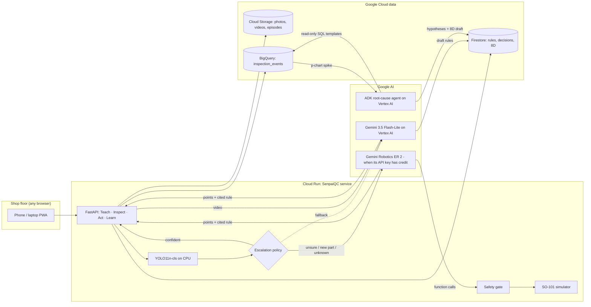

# SenpaiQC: pitch narrative

*Google Cloud AI Builder Cup 2026 · Manufacturing: Intelligent Operations & Industrial Efficiency*

> **One line:** a senior inspector teaches it once on video; it checks every part, decides
> pass / rework / scrap, tells the operator how to fix it in their own language, and when
> defects spike it finds the root cause and drafts the 8D report. A person stays in charge of
> every scrap and every rule.

Every number in this document comes from `eval/results/` or `docs/api-check.md`, measured on
2026-10-17. Anything synthetic or not yet measured is labelled as such.

---

## 1. The problem

**Who:** Tier-2 and Tier-3 component suppliers (metal casting, stamping, moulding) in Indonesia,
Thailand, Vietnam and Malaysia, feeding automotive and electronics supply chains. One concrete
example is the metal-casting cluster of Ceper, Klaten (Central Java).

**What goes wrong on their floor today:**

1. **Quality depends on who is on shift.** Visual inspection is manual. A tired or new inspector
   lets defects through, or scraps good parts.
2. **The best judgment walks out the door.** A senior inspector with 20 years on the line knows
   which porosity is acceptable and which is not. That knowledge is tacit, never written down,
   and it leaves when they retire.
3. **Escapes are expensive.** A defect that reaches the customer brings sorting at the customer's
   site, chargebacks and an 8D report. Compiling the evidence for an 8D takes a QC engineer days.
4. **Classic machine vision does not fit SMEs.** It needs thousands of labelled images per part
   number plus an integrator. SMEs launch new part numbers often and cannot afford that.
5. **The floor is multilingual.** Operators speak Bahasa Indonesia, Thai or Vietnamese; customers
   and auditors want English.

> **[Insert one real quote from a QC engineer or plant owner, used with permission.]**

**Why now:** Gemini Robotics ER 2 brings spatial reasoning (pointing at a defect) through a public
API. Small YOLO models run on a CPU. Agent frameworks (ADK) can reason over plant data safely.
Together they make expert-grade inspection affordable for a small plant.

---

## 2. The solution

SenpaiQC is a **closed quality loop** that turns one expert's knowledge into every shift's
standard: **Teach → Inspect → Act → Learn → Improve.**

The core idea is to use the right tool for each job, with plain code wherever possible:

| Job | Who does it | Why |
|---|---|---|
| Screen every part | **YOLO** on CPU | Fast and nearly free; it handled 99% of parts in our test |
| Judge the hard cases | **Gemini Robotics ER 2**, with automatic fallback to **Gemini 3.5 Flash-Lite on Vertex AI** | Points at the defect and cites the expert's rule; needs no labelled data |
| Turn an expert video into rules | **Gemini on Vertex AI** (3.5 Flash-Lite, video read straight from Cloud Storage) | Captures tacit knowledge in the expert's own words |
| Flag a defect spike | **Plain statistics** (p-chart, 3σ) | Deterministic and auditable; no AI needed |
| Explain the spike, draft the 8D | **ADK agent** with read-only BigQuery tools | Reasoning over data, never free-form SQL |
| Final say on scrap and rules | **A person** | Always |

### What makes it different

- **Expert-taught, not label-trained.** A new part number works on day one: the expert records a
  2–3 minute video and approves the drafted rules. No labelling project.
- **Every AI decision cites its source.** ER 2 names the expert rule it used (for example
  `imp-200-porosity-v1`), so an inspector can check the reasoning instead of trusting a score.
- **One decision drives a person or a robot.** The same result produces rework steps for an
  operator, or function calls for a robot arm behind a safety gate.
- **It gets cheaper over time.** Inspector-confirmed Gemini decisions are exported as YOLO
  labels, so the fast model learns the hard cases (teacher–student loop).
- **It closes the loop.** It goes past "defect detected" to *why* it happened and the customer
  report.

---

## 3. Features, by the person who uses them

**Senior inspector: Teach**
- Upload or record a narrated video; Gemini drafts one rule card per defect: what it looks
  like, where it appears, the accept limit, severity, how to fix it, how to look at it, and the
  video timestamp.
- Edit and approve each rule. Drafts are never used on the line, and editing an approved rule
  sends it back for approval.

**Line operator: Inspect and Act**
- Take a photo with a phone (or pick a sample part). The decision comes back as a large
  pass / rework / scrap banner, with the defect circled on the photo.
- "Why" shows the rationale and the expert rule used. "What to do now" lists rework steps in
  English, Bahasa Indonesia, Thai or Vietnamese, with tick boxes.
- Scrap needs a second tap, because it cannot be undone.

**Inspector / supervisor: Confirm**
- "Needs confirmation" queue: every scrap, every defect with no matching rule, and every
  result the model could not return in a valid form waits for a person. Overrides are logged; the person's call is what the
  quality record keeps.

**QC engineer: Learn**
- p-chart per defect and shift; a point above the 3σ limit opens an investigation.
- "Find root cause": the ADK agent tests machines, moulds, material lots and their combinations,
  ranks hypotheses with numbers, and names exactly what it blames.
- An 8D editor (D1–D8) pre-filled by the agent and finished by the engineer; Markdown download.
- Exports: an inspection audit trail (AI call vs human call, rule cited, latency, cost) and the
  expert rules register.

**Everyone: Ask SenpaiQC**
- Ask in English or Bahasa Indonesia, for example "what is the porosity limit and how do I fix
  it?" or "what caused the spike?". Answers come only from the plant's records (expert rules,
  investigations, 8D reports, statistics, model evaluation), always cite their sources, and say
  "not found in records" instead of guessing. Measured: about 2–5 s and $0.002 per question.

**Plant manager: Overview**
- A role-aware "What needs you now" list, live parts inspected, share sent to Gemini, cost per
  1,000 parts, open spikes.

**Robot cell (optional)**
- ER 2 plans `pick → present_to_camera → place_in_bin → stop` by function calling, presenting
  the part at the angle the expert's rule describes for a **second look**. A safety gate checks
  every call: allowed function, right part, valid bin, workspace limits, and scrap only after a
  human confirm. If the two looks disagree, the part goes to a **hold** bin for a person.

---

## 4. Architecture and workflow

### Step by step

| Step | Input | What happens | Output |
|---|---|---|---|
| **1. Teach** | Expert's narrated video | Gemini Flash returns rule cards under a strict response schema, validated with Pydantic and retried once. The expert edits and approves | Approved rule cards (Firestore) |
| **2. Inspect** | Part photo + line context (machine, mould, lot) | YOLO scores it. Confidence ≥ 0.85 on a known class: YOLO decides. Otherwise (0.40–0.85, unknown class, or a part with fewer than 50 labels), ER 2 gets the photo and the approved rules, points at each defect (`[y, x]` in 0–1000, converted to pixels) and cites a rule | Decision, defect points, cited rule, rationale, latency, cost |
| **3. Guardrails** | The decision | Plain code: an uncited defect can never pass; scrap, uncited or schema-invalid results go to a person | `needs_human_confirm` flag |
| **4. Act** | Confirmed decision | Rework steps from the cited rule, translated and cached per language; or the robot plan through the safety gate | Operator guide / robot episode |
| **5. Record** | Every final decision | Written to BigQuery (flagged ones only after the human confirm) | `inspection_events` row |
| **6. Learn** | BigQuery events | A p-chart per defect, with limits from the first 10 days so a spike cannot widen its own limits. The ADK agent may only call `query_events` (named templates with bound parameters), `get_cards`, `get_process_context` and `draft_8d` | Investigation, ranked hypotheses, 8D draft |
| **7. Improve** | Confirmed ER 2 decisions | Exported as Ultralytics labels; YOLO retrains | Fewer escalations, lower cost |

**Engineering choices judges can check:** hexagonal architecture (domain code imports no Google
SDK, so ER 2 can be swapped for a fallback without touching business logic); production runs
Gemini on **Vertex AI** with the Cloud Run service account (no API key in the container), and a
circuit breaker moves hard parts to Flash-Lite when ER 2 is unavailable; every Gemini call is
schema-enforced with retry and backoff; the agent never writes SQL; secrets live in Secret Manager; synthetic rows are
tagged `SYN-` and excluded from latency and cost metrics; an offline mode runs without any key
and never presents its output as AI judgment.

---

## 5. Results (measured)

### Inspection: held-out golden set

200 images (100 good, 100 defective) from the dataset's **test split**. They were never used for
training or threshold tuning. Run on 2026-10-17 with real YOLO, Gemini Robotics ER 2 and Gemini
3.8 Flash.

| Metric | Result | Note |
|---|---|---|
| Defect recall | **99%** (99 of 100 defective parts caught) | |
| False reject rate | **0%** (0 of 100 good parts rejected) | |
| Decided by the fast path (YOLO, CPU) | **99%** (198 of 200) | 198 of 198 YOLO decisions were correct |
| Escalated to Gemini ER 2 | **1%** (2 of 200) | |
| p95 latency, fast path (end to end) | **171 ms** | Model alone: 16 ms p95 on CPU |
| Latency, ER 2 path | **6.6–7.2 s** | Only 2 calls in this run |
| Cost per 1,000 parts | **$0.07** | From logged Gemini token cost at published prices |
| YOLO validation top-1 | **99.7%** | yolo11n-cls, 224 px, 15 epochs, 5,639 labelled training images |

**The one miss, stated plainly:** both escalated parts were hard cases. ER 2 judged both as
"pass", which was right for the good part and wrong for the defective one. So the single missed
defect in 200 came from the Gemini path, not from YOLO. This is why we treat "escalated + pass"
as a candidate for mandatory human review (see limitations).

**What $0.07 per 1,000 parts means:** at the measured 1% escalation rate, a line inspecting
5,000 parts per shift would spend about **$0.35 per shift** on Gemini. That figure is an
arithmetic projection from the measured rate; real cost depends on how many parts are hard.

### Production deployment (Cloud Run + Vertex AI)

Measured on 2026-10-18 against the live service (Cloud Run in `us-central1`, the lowest-price tier; Gemini on
the Vertex AI `global` endpoint with `gemini-3.5-flash-lite`). Re-run after the move from Jakarta:
same decisions and the same root cause (MD-04 + LOT-2409C) in 31 s.

| Action on the deployed app | Result | Time | Gemini cost |
|---|---|---|---|
| Easy part, YOLO fast path | Correct decision | about 1 s | $0 |
| Hard part, escalated to Gemini on Vertex AI | Rework, citing the approved rule | 3.3 s | $0.0015 |
| Ask SenpaiQC, in Bahasa Indonesia | Correct limit, cited porosity rule | 1.3 s | $0.0008 |
| Root-cause agent (ADK on Vertex AI, 13 read-only tool calls on BigQuery) | **Mould MD-04 + lot LOT-2409C**, 8D draft created | 30 s | $0.027 |

Expected spend for the demo and judging period: about $2-3 in total (Gemini, Cloud Run scaled to
zero, Firestore, BigQuery, Storage), capped by the app's daily AI budget and a single instance.

### Spatial pointing check (ER 2)

On a test image with a known dark spot at pixel (420, 160), ER 2 returned `[333, 657]`; the
expected value was `[333, 656]` (`[y, x]`, normalised 0–1000). The call took 4.1 s.

### Root cause: planted-cause scenario (synthetic process data)

30 days × 2 shifts, 3 machines with 2 moulds each, **synthetic**, with one planted cause: from day 18,
lot `LOT-2409C` on mould `MD-04` raises porosity from about 3% to about 30%. The machine that
hosts that mould is a decoy.

| Metric | Result |
|---|---|
| SPC flag | First out-of-control shift: **2026-09-25 / A**, the first affected day |
| Root cause named by the ADK agent | **mould MD-04 + material lot LOT-2409C** (correct, the interaction, not the decoy) |
| Agent tool calls | 17 (all read-only, templated) |
| Spike flagged → 8D draft ready | **4.4 minutes** with Gemini 3.8 Flash (agent run 266 s); **30 s** in production on Vertex AI Flash-Lite |
| Cost of the investigation | **$0.10** with Gemini 3.8 Flash; **$0.027** on Vertex AI Flash-Lite |

---

## 6. Impact

**For the people on the floor**
- An operator gets a clear decision and fix steps in their own language, at the line, on a
  phone. No training on a new machine-vision system.
- A senior inspector's judgment is captured once and keeps working after they retire. The
  rules are versioned and traceable to the video timestamp they came from.
- A QC engineer starts an 8D from evidence-ranked hypotheses instead of a blank page: minutes to
  a draft (measured: 30 s in production, 4.4 min in the first evaluation run) instead of days
  of manual compilation.

**For the plant**
- **Quality:** every part is inspected the same way on every shift (measured: 99% recall, 0%
  false rejects on held-out images).
- **Efficiency:** the cheap path handles almost everything (99% on CPU at 171 ms); Gemini is
  used only where judgment is needed ($0.07 per 1,000 parts measured).
- **Waste:** fewer escapes, and fewer good parts scrapped. Root causes found earlier stop scrap
  from the same cause from piling up.
- **Trust and audit:** every decision records the AI's call, the human's call, the rule cited,
  the time and the cost, which is the audit trail an automotive customer asks for.

**Why it scales across JAPAC**
- No labelling project per part number: a new part needs one expert video.
- Runs on hardware an SME already has (a phone and a browser); one Cloud Run service; pay per use.
- Multilingual by design (English, Bahasa Indonesia, Thai, Vietnamese).
- The same loop applies to stamping, moulding and machining: only the expert's rules change.

---

## 7. Limitations (honest)

| Limitation | Why it matters | What we do about it |
|---|---|---|
| **The Gemini path is measured on only 2 parts.** The golden set was easy for YOLO | Too few to claim ER 2 accuracy | Next: a harder test set (blurred, angled, new parts) where escalation is common |
| **The single miss came from ER 2 passing a defective part** | An "escalated + pass" is currently auto-accepted | Route every escalated pass to a person until citation accuracy is measured |
| **Expert-rule citation accuracy is not yet measured** (needs 30 hand-checked escalations) | It is the core claim of "explainable" AI | `eval/sample_citations.py` prepares the review sheet |
| **Teacher–student escalation drop is not yet measured** | The "gets cheaper" claim is designed, not proven | Export confirmed labels → retrain → `run_all.py --weights-after` |
| **Rule cards in the demo are synthetic seed cards** (`approved_by: demo-seed`); no real expert video recorded yet | Accept limits are illustrative, not a plant standard | Record one narrated video; have a QC engineer correct one card |
| **Process data for root cause is synthetic**, with a planted cause | Proves the method, not field performance | Run on one real plant's inspection log |
| **Dataset:** one part type, top view, grayscale; reportedly augmented, so train and test images may be near-duplicates | Scores may be optimistic | Validate on local SME photos (cold start) |
| **Dataset licence still to be confirmed** on the Kaggle page; Ultralytics is AGPL-3.0 | Submission compliance | Confirm and record in `docs/licences.md` |
| **Robot is a scripted kinematic simulator**, and the "second look" is a digital zoom, not a re-rendered view; no second-look episodes measured yet | It is a demo of orchestration and safety, not of manipulation | Plug a LeRobot SO-101 simulation or a real arm into the same port |
| **ER 2 latency (≈7 s) is too slow for every part at line rate** | Throughput | By design only ~1% of parts reach it; the rest take 171 ms |
| **ER 2 is not served on Vertex AI.** It runs only through the Gemini API key; when that key has no credit, hard parts go to Flash-Lite on Vertex AI | The golden-set numbers above were measured with ER 2; production numbers use the fallback | The UI and the audit trail record which model judged each part; re-run `eval/run_all.py` on the fallback path |
| **Hosted in `us-central1`, models on the Vertex AI `global` endpoint** (chosen for cost) | Plant data and model calls are processed outside Indonesia | For data residency, redeploy with `REGION=asia-southeast2 SUFFIX=id` and a regionally served model via `VERTEX_LOCATION`; Storage, Firestore and BigQuery get their own region-specific names |

---

## 8. Judging criteria map

| Criterion (weight) | Evidence |
|---|---|
| **Technical & Gen AI (40%)** | ER 2 spatial pointing with rule citation and fallback to Gemini on Vertex AI; Gemini video-to-rules; ADK agent on Vertex AI with read-only tools that found the planted cause; schema-enforced calls with retry; hybrid YOLO + Gemini routing; Secret Manager and least-privilege service account; one Cloud Run service with Firestore, Cloud Storage and BigQuery (https://senpaiqc-568251697792.us-central1.run.app) |
| **Problem & impact (25%)** | SME casting suppliers in JAPAC; measured recall, false rejects, cost and time to 8D; multilingual operator guidance; real quote **[to insert]** |
| **Innovation (25%)** | Expert-taught with no labelling; one decision drives a person or a robot; teacher–student loop; a closed Kaizen loop from detection to 8D |
| **UX (10%)** | Mobile-first web app, role-aware home, one-tap language switch, tick-box rework steps, two-tap scrap, sample parts for anyone without a part at hand |

---

## 9. 60-second spoken pitch

> In a casting plant in Central Java, quality depends on who is on shift. The best inspector
> knows exactly which pinhole is acceptable, but that knowledge lives in their head and leaves
> when they retire. When a defect escapes, the customer demands an 8D report, and the QC
> engineer loses days compiling it.
>
> SenpaiQC lets that inspector teach once, on video. Gemini turns the explanation into rules
> in their own words, and they approve them. On the line, an operator takes a photo. A small
> YOLO model decides the easy parts in under 200 milliseconds. The hard ones go to Gemini on
> Google Cloud, which points at the defect and tells you which expert rule it used. The
> operator gets the fix steps in Bahasa Indonesia, and every scrap still needs a person.
>
> Every decision lands in BigQuery. When defects spike, a statistical rule flags it, and an ADK
> agent on Vertex AI finds the cause. On the live system it named the exact mould and material
> lot and drafted the 8D in 30 seconds, for under 3 cents.
>
> On 200 held-out parts we measured 99% recall, zero good parts rejected, and 7 cents per
> thousand parts in AI cost. It runs on a phone, one Cloud Run service and Gemini on Vertex AI. That makes
> expert-grade inspection affordable for the small suppliers who need it most.

---

## 10. Before you submit: fill these in

- [x] Public Cloud Run URL: https://senpaiqc-568251697792.us-central1.run.app (token from Secret Manager in the submission notes)
- [ ] One real QC engineer / plant owner quote, with permission
- [ ] Dataset licence confirmed in `docs/licences.md`
- [ ] (If time allows) one real narrated expert video → approved cards → replace the seed cards
- [ ] Update this file if `eval/run_all.py` is re-run; keep every number traceable to `eval/results/`
