# SenpaiQC: submission narrative

*Google Cloud AI Builder Cup 2026 · Manufacturing: Intelligent Operations & Industrial Efficiency*

Follows the order of the official submission template (Team details → Links). Every number comes
from `eval/results/`, `docs/api-check.md` or a logged call on the live service, measured on
2026-10-17/18. Anything synthetic or projected is labelled as such.

> **One line:** a senior inspector teaches it once on video; it checks every part, decides
> pass / rework / scrap, tells the operator how to fix it in their own language, and when
> defects spike it alerts the QC team, finds the root cause and drafts the 8D report. A person
> stays in charge of every scrap and every rule.

---

## 1. Team details

| | |
|---|---|
| **a. Team name** | SenpaiQC |
| **b. Team leader name** | Simon Surya Keban |
| **c. Problem statement** | Small casting suppliers in Southeast Asia depend on manual visual inspection, so quality changes with who is on shift, the best inspector's judgment is lost when they retire, and every defect that escapes costs days of 8D work. Machine vision that needs thousands of labelled images per part number is out of their reach. |

**Who has this problem.** Tier-2 and Tier-3 component suppliers (metal casting, stamping,
moulding) in Indonesia, Thailand, Vietnam and Malaysia, feeding automotive and electronics supply
chains. One concrete example is the metal-casting cluster of Ceper, Klaten (Central Java).

**What goes wrong on their floor today**

1. **Quality depends on who is on shift.** A tired or new inspector lets defects through, or
   scraps good parts.
2. **The best judgment walks out the door.** A senior inspector with 20 years on the line knows
   which porosity is acceptable. That knowledge is tacit, never written down, and leaves when they retire.
3. **Escapes are expensive.** A defect at the customer means sorting, chargebacks and an 8D
   report that takes a QC engineer days to compile.
4. **Classic machine vision does not fit SMEs.** Thousands of labelled images per part number
   plus an integrator; SMEs launch new part numbers often.
5. **The floor is multilingual.** Operators speak Bahasa Indonesia, Thai or Vietnamese;
   customers and auditors want English.

> **[Insert one real quote from a QC engineer or plant owner, used with permission.]**

---

## 2. Brief about the idea

SenpaiQC is an **expert-taught inspection and rework cell** that closes the quality loop:
**Teach → Inspect → Act → Learn → Improve.**

- **Teach.** A senior inspector records a short narrated video. Gemini on Vertex AI turns it into
  one rule card per defect (look, location, how to inspect, accept limit, fix, video timestamp).
  The expert approves each card; drafts never reach the line.
- **Inspect.** An operator takes a phone photo. A small YOLO model on CPU decides the easy parts.
  Unclear, unknown or new parts go to Gemini, which points at the defect and cites the expert
  rule it used.
- **Act.** The decision becomes rework steps in the operator's language, or a plan for a robot
  arm behind a safety gate. Scrap always needs a person.
- **Learn.** Every decision lands in BigQuery. A p-chart flags spikes; Pub/Sub alerts the QC team
  on Telegram; an ADK agent finds the root cause with read-only queries and drafts the 8D report.
- **Improve.** Inspector-confirmed Gemini decisions become YOLO training labels, so the cheap
  model learns the hard cases.

It uses AI only where judgment is needed and plain code everywhere else:

| Job | Who does it | Why |
|---|---|---|
| Screen every part | **YOLO11n-cls** on CPU | Fast and nearly free; 99% of parts in our test |
| Judge the hard cases | **Gemini Robotics ER 2**, fallback **Gemini 3.5 Flash-Lite on Vertex AI** | Points at the defect and cites the expert's rule; no labelled data |
| Turn an expert video into rules | **Gemini on Vertex AI** (video read straight from Cloud Storage) | Captures tacit knowledge in the expert's own words |
| Flag a defect spike | **Plain statistics** (p-chart, 3σ) | Deterministic and auditable |
| Tell the QC team | **Pub/Sub → Telegram / Google Chat** | Delivered with retries, never blocks the line |
| Explain the spike, draft the 8D | **ADK agent** with read-only BigQuery tools | Reasons over data, never writes SQL |
| Final say on scrap and rules | **A person** | Always |

---

## 3. Opportunities

### How is it different from existing ideas?

| Existing approach | Its gap for an SME | SenpaiQC |
|---|---|---|
| Classic machine vision (labelled-data models, integrator) | Thousands of labelled images per part; weeks per new part number | **Expert-taught**: one narrated video per part; YOLO only screens, Gemini judges with the expert's rules |
| Generic "AI defect detection" | A confidence score with no reason; stops at "defect found" | **Every AI decision cites the approved rule** and points at the defect; continues to rework, root cause and 8D |
| Manual QC with paper standards | Depends on the inspector on shift; tacit limits never written | The senior inspector's words become versioned, approved rule cards with video timestamps |
| SPC software | Flags a spike but leaves the "why" to a person | ADK agent tests machines, moulds, lots and their combinations and drafts the 8D |

### How will it solve the problem?

- **Consistency across shifts:** every part is checked the same way (measured: 99% recall,
  0% false rejects on 200 held-out images).
- **Knowledge that stays:** rules come from the expert's own video and are approved by them.
  Measured: a 2-minute teach video became 4 draft rule cards in 9.4 s, for $0.005.
- **Faster escapes response:** spike → alert → root cause → 8D draft in about 30 s on the live
  service, instead of days.
- **Affordable:** 99% of parts never leave the CPU; Gemini costs $0.07 per 1,000 parts at the
  measured escalation rate.
- **Multilingual:** rework steps and answers in English, Bahasa Indonesia, Thai or Vietnamese.

### USP

1. **Teach once, no labelling project.** A new part number works on day one.
2. **Explainable by construction.** An uncited defect can never pass; scrap, unknown and invalid
   results always go to a person.
3. **One decision drives a person or a robot** (same rules, same safety gate).
4. **It closes the loop:** detection → fix → alert → root cause → 8D → retraining.
5. **Runs on what an SME already has:** a phone, a browser and one Cloud Run URL.

---

## 4. List of features offered by the solution

| Who | Feature | What it does |
|---|---|---|
| Senior inspector | **Teach from video** | Upload or record a narrated video (up to 10 min / 500 MB, signed upload to Cloud Storage). Gemini drafts one rule card per defect with the video timestamp |
| Senior inspector | **Rule approval** | Edit and approve each card; editing an approved rule sends it back for approval; cards are versioned |
| Line operator | **Inspect** | Phone photo or sample part → large pass / rework / scrap banner with the defect circled and the rule cited |
| Line operator | **Rework guide** | Tick-box steps from the cited rule, in English, Bahasa Indonesia, Thai or Vietnamese; scrap needs a second tap |
| Inspector / supervisor | **Needs confirmation** | Queue of every scrap, unknown defect and invalid model result; overrides are logged |
| QC engineer | **Quality analytics** | p-chart per defect and shift, Pareto, live cost and latency; evaluation results |
| QC engineer | **Spike alerts** | New spike → Pub/Sub → Telegram or Google Chat, with retries and a test button |
| QC engineer | **Root-cause agent** | ADK agent on Vertex AI ranks hypotheses (machine, mould, lot, combinations) with evidence |
| QC engineer | **8D reports** | D1–D8 pre-filled by the agent; edit, approve, export `.docx` for Word / Google Docs |
| Everyone | **Ask SenpaiQC** | Q&A only from the plant's records, with citations; "not found in records" instead of guessing |
| Plant manager | **Overview** | Role-aware "what needs you now", parts inspected, share sent to Gemini, cost per 1,000 parts |
| Optional | **Robot cell** | Gemini plans pick → present to camera → place in bin; safety gate on every call; second look; hold bin on disagreement; 3D replay |
| Platform | **Guardrails** | Human confirm for scrap, schema-validated model output with retry, model circuit breaker, per-user and daily AI budgets, CSP, secrets only in Secret Manager |

---

## 5. Process flow diagram

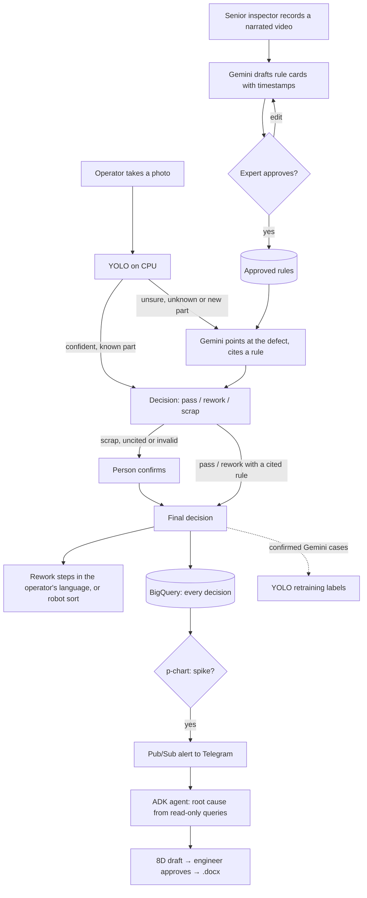

### Step by step

| Step | Input | What happens | Output |
|---|---|---|---|
| **1. Teach** | Expert's narrated video | Gemini returns rule cards under a strict response schema, validated with Pydantic and retried. The expert edits and approves | Approved rule cards (Firestore) |
| **2. Inspect** | Part photo + line context (machine, mould, lot) | YOLO confidence ≥ 0.85 on a known class: YOLO decides. Otherwise (0.40–0.85, unknown class, or a part with fewer than 50 labels) Gemini gets the photo and the approved rules, points at each defect and cites a rule | Decision, defect points, cited rule, rationale, latency, cost |
| **3. Guardrails** | The decision | Plain code: an uncited defect can never pass; scrap, uncited or schema-invalid results go to a person | `needs_human_confirm` flag |
| **4. Act** | Confirmed decision | Rework steps from the cited rule, cached per language; or the robot plan through the safety gate | Operator guide / robot episode |
| **5. Record** | Every final decision | Written to BigQuery (flagged ones only after the human confirm) | `inspection_events` row |
| **6. Learn** | BigQuery events | p-chart with limits from the first 10 days, so a spike cannot widen its own limits. A new investigation goes to Pub/Sub, which pushes it back for delivery to Telegram. The ADK agent may only call named SQL templates, `get_cards`, `get_process_context` and `draft_8d` | Alert, ranked hypotheses, 8D draft |
| **7. Improve** | Confirmed Gemini decisions | Exported as Ultralytics labels; YOLO retrains | Fewer escalations, lower cost |

---

## 6. Wireframes / mock diagrams

The prototype is built, so these are the real screens (more in section 9).

| Phone at the line | Rework guide |
|---|---|
| 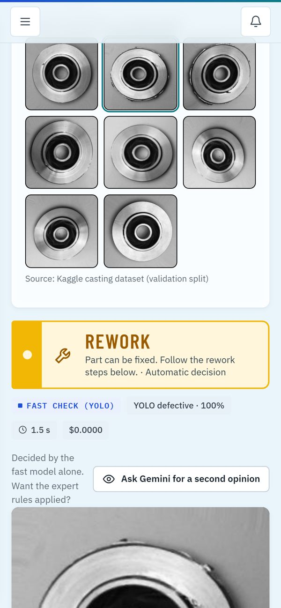 | 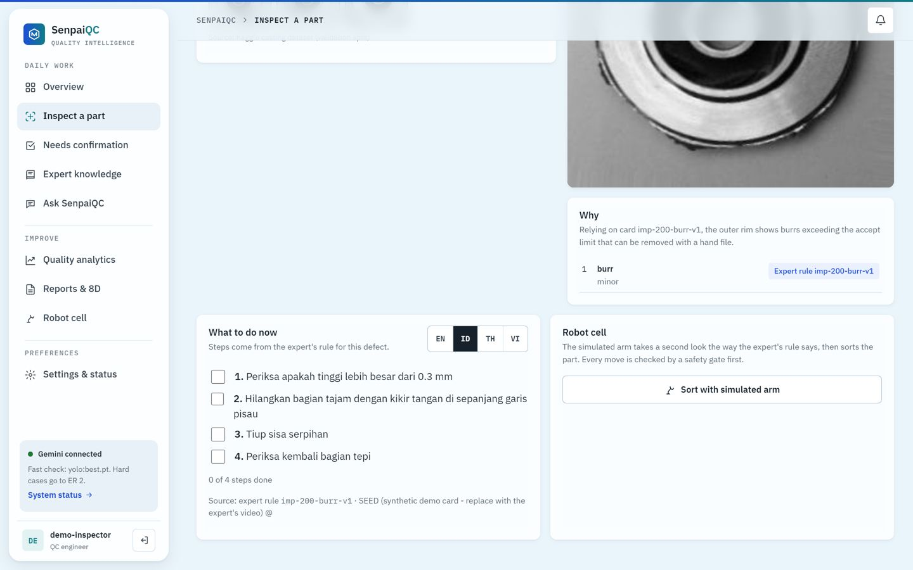 |

---

## 7. Architecture diagram

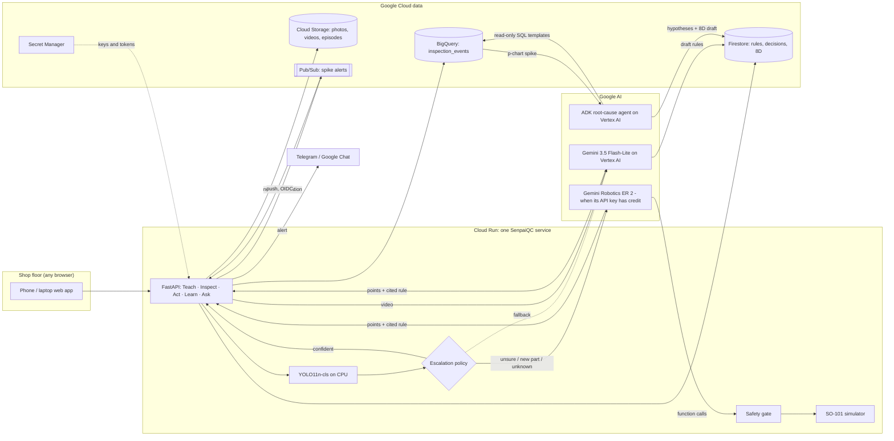

**Engineering choices judges can check:** hexagonal architecture (domain code imports no Google
SDK, so models and stores are swapped through ports); Gemini on **Vertex AI** with the Cloud Run
service account (no API key needed for it), and a circuit breaker that moves hard parts to
Flash-Lite when ER 2 is unavailable; every Gemini call is schema-enforced with retry and backoff;
the agent never writes SQL; the alert push endpoint accepts only OIDC tokens signed as the
service account; secrets live in Secret Manager; synthetic rows are tagged `SYN-` and excluded
from latency and cost metrics; an offline mode runs without any key and never presents its
output as AI judgment.

---

## 8. Technologies used in the solution

| Layer | Technology |
|---|---|
| **Google AI** | Gemini Robotics ER 2 (spatial pointing, function calling); Gemini 3.5 Flash-Lite on **Vertex AI** (video understanding, rework steps, Q&A, fallback judge); **Agent Development Kit (ADK)** for the root-cause agent; `google-genai` SDK |
| **Google Cloud** (11 services) | Cloud Run, Cloud Build, Artifact Registry, Vertex AI, Gemini API, Firestore (named database), Cloud Storage (V4 signed uploads), BigQuery, Pub/Sub (push with OIDC), Secret Manager, IAM Credentials |
| **Vision** | Ultralytics YOLO11n-cls on CPU (PyTorch CPU build), OpenCV |
| **Backend** | Python 3.12, FastAPI, Pydantic, hexagonal architecture (domain / ports / adapters / vertical slices), python-docx for 8D export |
| **Frontend** | React + Vite, TypeScript, mobile-first web app, Three.js 3D robot replay with 2D fallback, self-hosted IBM Plex fonts |
| **Alerts** | Pub/Sub topic + push subscription → Telegram Bot API / Google Chat webhook |
| **Quality** | pytest suite (45 tests, offline adapters, no keys), `eval/run_all.py` for every metric |
| **Data** | Public casting dataset (Kaggle, pump impellers); synthetic process history with one planted cause |

---

## 9. Estimated implementation cost

**Measured on the live service** (Gemini cost from logged tokens at published prices):

| Action | Gemini cost |
|---|---|
| Easy part, YOLO fast path | $0 |
| Hard part, escalated to Gemini on Vertex AI | $0.001–0.002 |
| Teach video (2 min) → 4 rule cards | $0.005 |
| Ask SenpaiQC question | $0.0008–0.0016 |
| Root cause + 8D draft | $0.027 |
| Gemini per 1,000 parts (golden set, 1% escalated) | $0.07 |

**Projection for one line** (arithmetic from the measured rate, not measured in a plant):
5,000 parts per shift × 1% escalated × about $0.0015 = **about $0.08 per shift** in Gemini, or
**about $6 a month** for three shifts. Cloud Run scales to zero between uses, and Pub/Sub,
Firestore, BigQuery and Storage stay within or near their free tiers at one-line volume.

**Demo and judging period:** about $2–3 in total, capped by the app's daily AI budget (300 units
per instance) and a single Cloud Run instance in `us-central1`, the lowest-price tier.

**Hardware:** none beyond what an SME has: a phone or tablet at the line and any browser. A real
robot arm (for example SO-101) is optional.

---

## 10. Snapshots of the prototype

Live at https://senpaiqc-568251697792.us-central1.run.app (desktop and phone).

| | |
|---|---|
| 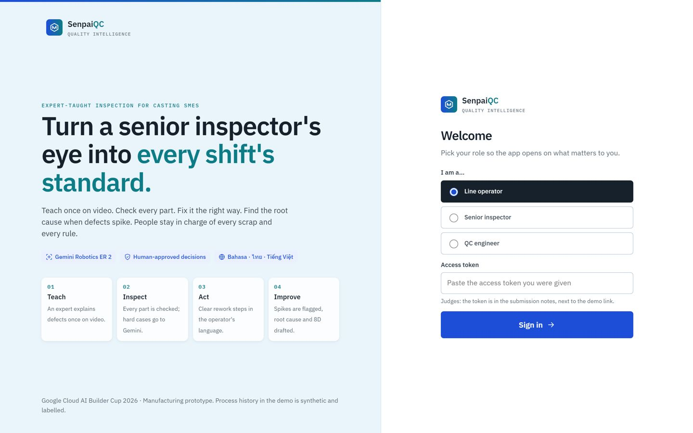 **Sign-in** with role choice | 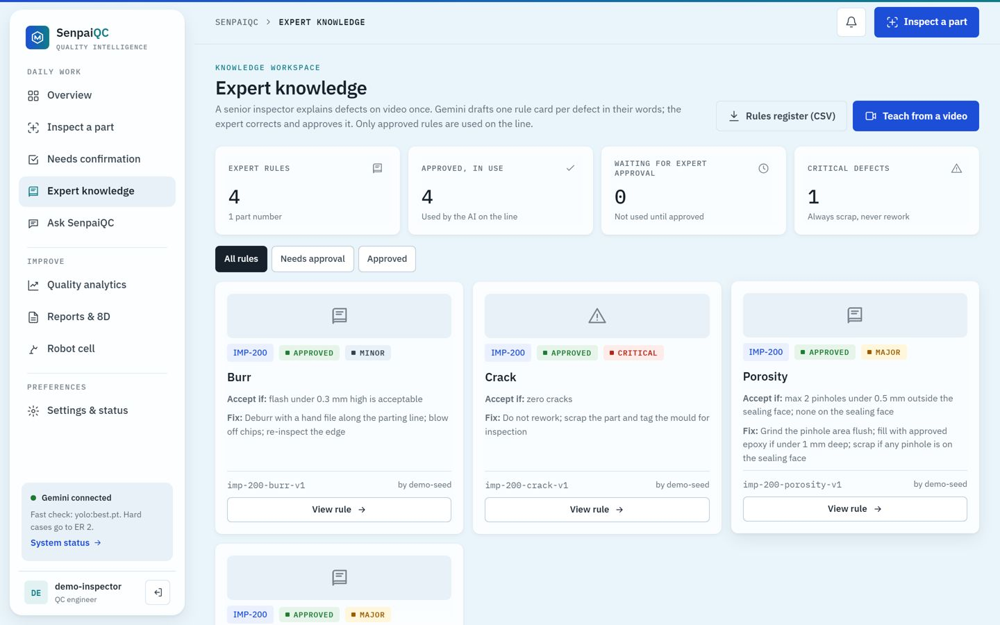 **Teach:** approved rule cards |
| 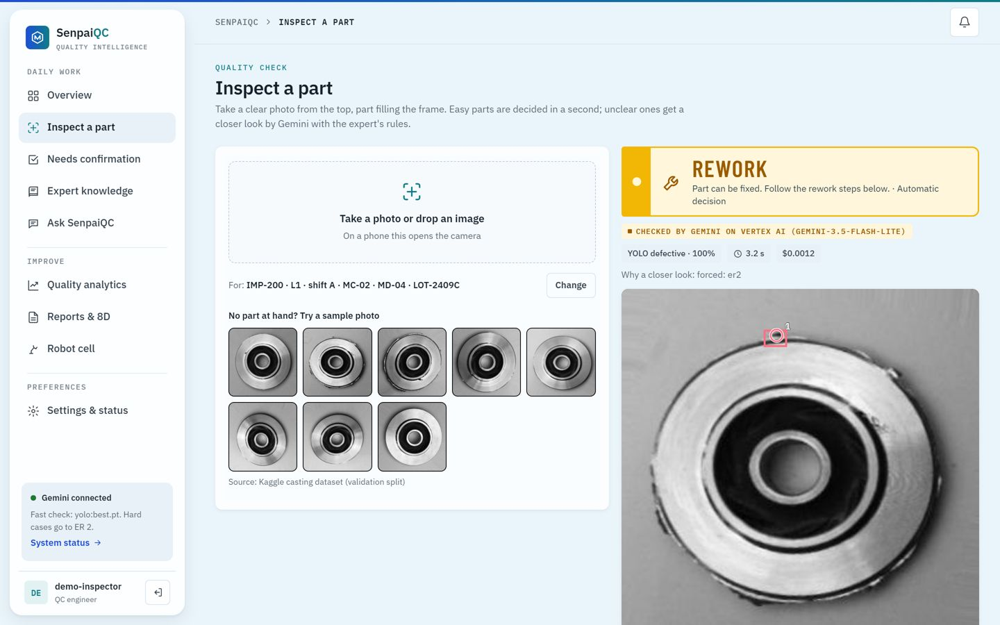 **Inspect:** Gemini circles the defect and cites the rule | 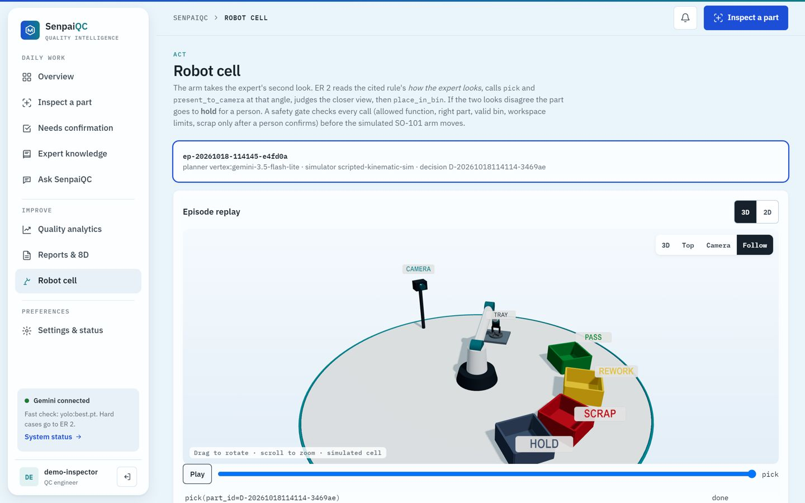 **Act:** simulated SO-101 cell, 3D replay |
| 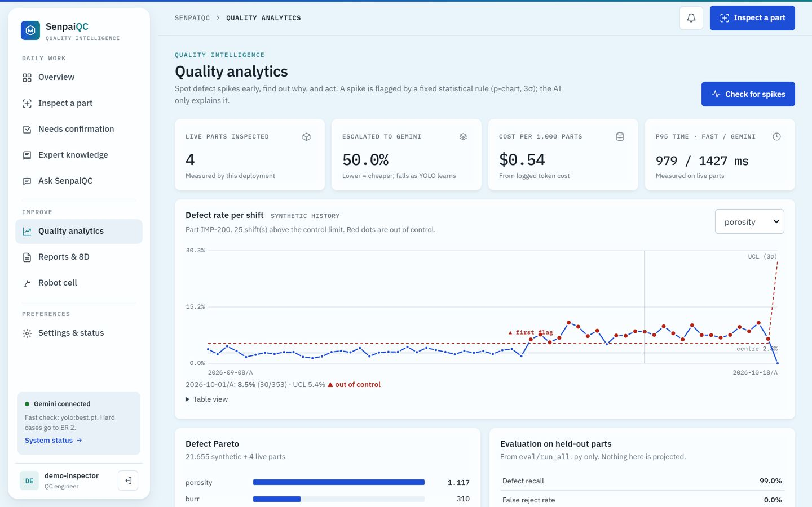 **Learn:** p-chart flags the spike | 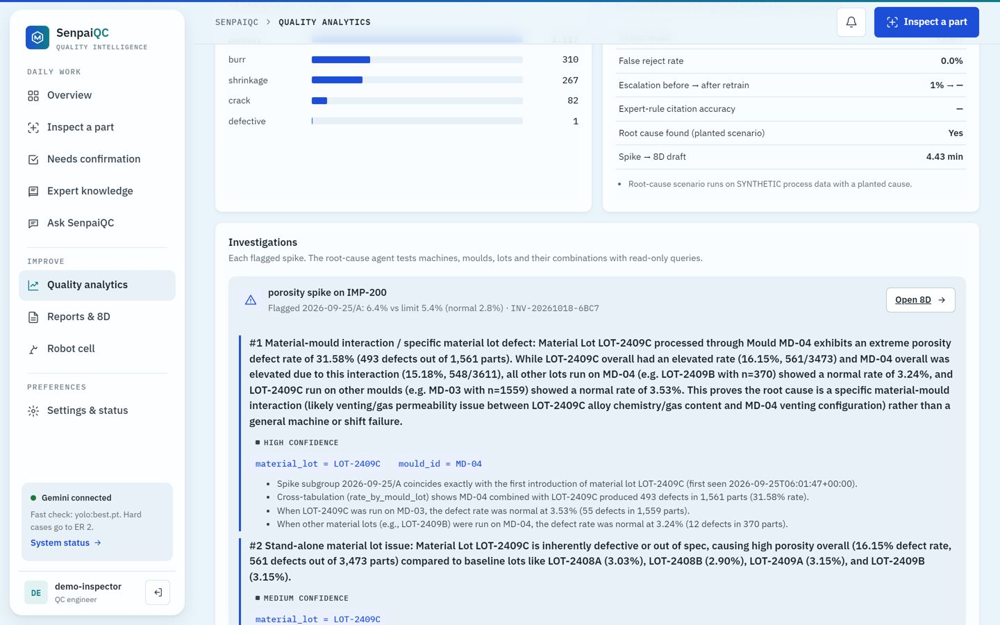 **Root cause** found by the ADK agent |
| 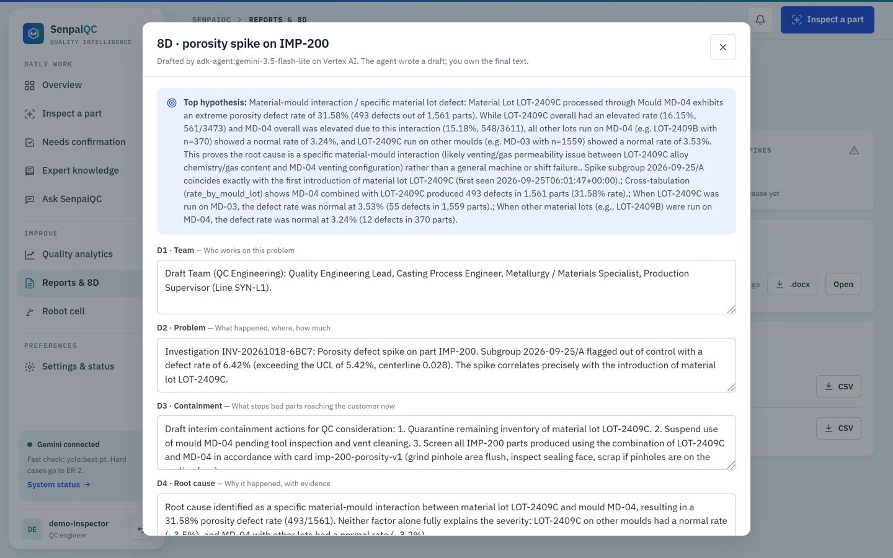 **8D draft**, export to Word / Google Docs | 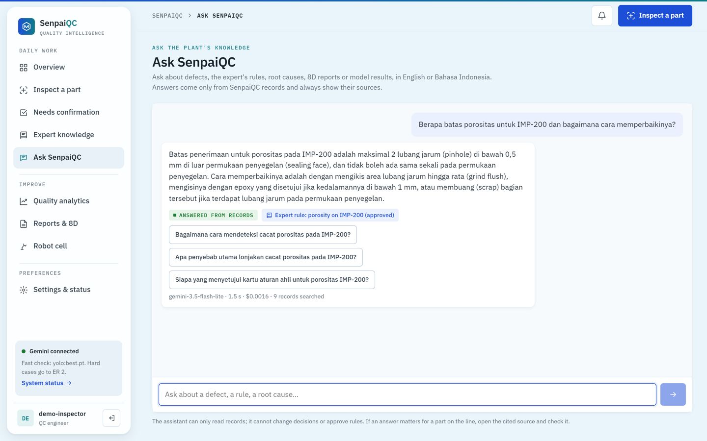 **Ask** in Bahasa Indonesia, with citation |

---

## 11. Prototype performance report / benchmarking

### Inspection: held-out golden set

200 images (100 good, 100 defective) from the dataset's **test split**, never used for training
or threshold tuning. Run on 2026-10-17 with real YOLO, Gemini Robotics ER 2 and Gemini 3.8 Flash.

| Metric | Result | Note |
|---|---|---|
| Defect recall | **99%** (99 of 100) | |
| False reject rate | **0%** (0 of 100) | |
| Decided by the fast path (YOLO, CPU) | **99%** (198 of 200) | 198 of 198 YOLO decisions were correct |
| Escalated to Gemini ER 2 | **1%** (2 of 200) | |
| p95 latency, fast path (end to end) | **171 ms** | Model alone: 16 ms p95 on CPU |
| Latency, ER 2 path | **6.6–7.2 s** | Only 2 calls in this run |
| Cost per 1,000 parts | **$0.07** | Logged Gemini token cost at published prices |
| YOLO validation top-1 | **99.7%** | yolo11n-cls, 224 px, 15 epochs, 5,639 labelled training images |

**The one miss, stated plainly:** both escalated parts were hard cases. ER 2 judged both as
"pass", right for the good part and wrong for the defective one. So the single missed defect in
200 came from the Gemini path, not from YOLO, which is why "escalated + pass" should go to a person
until citation accuracy is measured.

### Teach: expert video to rule cards (live service, 2026-10-18)

| Metric | Result |
|---|---|
| Input | 1 min 58 s narrated video for IMP-200, 1080p, 24 MB, signed upload to Cloud Storage (31 s) |
| Rule cards drafted | **4 of 4** defects (porosity, shrinkage, crack, burr) |
| Fields matching the narration | **24 of 24** (cues, location, how to look, accept limit, fix, severity) |
| Video timestamps on the cards | 00:17, 00:43, 01:05, 01:27 |
| Gemini time / cost | **9.4 s / $0.005** (Gemini 3.5 Flash-Lite on Vertex AI, video read from Cloud Storage) |

### Production deployment (Cloud Run + Vertex AI, `us-central1`)

| Action on the deployed app | Result | Time | Gemini cost |
|---|---|---|---|
| Easy part, YOLO fast path | Correct decision | about 1 s | $0 |
| Hard part, escalated to Gemini on Vertex AI | Rework, citing the approved rule | 1.4–3.3 s | $0.001–0.002 |
| Ask SenpaiQC, in Bahasa Indonesia | Correct limit, cited porosity rule | 1.3 s | $0.0008 |
| Root-cause agent (ADK, 12–13 read-only tool calls on BigQuery) | **Mould MD-04 + lot LOT-2409C**, 8D draft created | about 30 s | $0.027 |
| Spike alert (Pub/Sub push → Telegram) | Delivered; failed attempts retried automatically | seconds | $0 |

### Root cause: planted-cause scenario (synthetic process data)

30 days × 2 shifts, 3 machines with 2 moulds each, **synthetic**, with one planted cause: from day
18, lot `LOT-2409C` on mould `MD-04` raises porosity from about 3% to about 30%. The machine that
hosts that mould is a decoy.

| Metric | Result |
|---|---|
| SPC flag | First out-of-control shift: **2026-09-25 / A**, the first affected day |
| Root cause named by the ADK agent | **mould MD-04 + lot LOT-2409C** (the interaction, not the decoy) |
| Spike → 8D draft | **30 s** on Vertex AI Flash-Lite (4.4 min with Gemini 3.8 Flash in the first evaluation run) |
| Cost of the investigation | **$0.027** on Vertex AI Flash-Lite ($0.10 with Gemini 3.8 Flash) |

### Spatial pointing check (ER 2)

On a test image with a known dark spot at pixel (420, 160), ER 2 returned `[333, 657]`; expected
`[333, 656]` (`[y, x]`, normalised 0–1000). The call took 4.1 s.

### Limitations (honest)

| Limitation | Why it matters | What we do about it |
|---|---|---|
| **The Gemini path is measured on only 2 golden-set parts** | Too few to claim Gemini accuracy | Next: a harder test set (blurred, angled, new parts) |
| **The single miss came from Gemini passing a defective part** | An "escalated + pass" is auto-accepted today | Route every escalated pass to a person until citation accuracy is measured |
| **Rule-citation accuracy and the teacher–student escalation drop are not yet measured** | "Explainable" and "gets cheaper" are designed, not proven | `eval/sample_citations.py` and `run_all.py --weights-after` |
| **The teach video was recorded by our team over slides that show the same text**; not yet by a plant inspector | It proves video-to-card extraction, not capture of an inspector's spontaneous explanation; limits are illustrative | Record one inspector at a real plant; have a QC engineer correct one card |
| **Process data for root cause is synthetic**, with a planted cause | Proves the method, not field performance | Run on one real plant's inspection log |
| **Dataset:** one part type, top view, grayscale, possibly augmented near-duplicates | Scores may be optimistic | Validate on local SME photos |
| **Robot is a scripted kinematic simulator**; the second look is a digital zoom | Orchestration and safety, not manipulation | Plug a LeRobot SO-101 simulation or a real arm into the same port |
| **ER 2 is not on Vertex AI** and needs a Gemini API key with credit; otherwise hard parts go to Flash-Lite | Golden-set numbers use ER 2; production numbers use the fallback | The UI and audit trail record which model judged each part |
| **Hosted in `us-central1`, models on the Vertex AI `global` endpoint** (chosen for cost) | Plant data is processed outside Indonesia | Redeploy with `REGION=asia-southeast2 SUFFIX=id` for data residency |
| **Only rework steps and Ask are multilingual**; the interface is English | Operators read menus in English | Translate the operator screens next |
| **Demo login is a shared token**, one instance, daily AI budget | Not multi-tenant, not production auth | `infra/deploy.sh` variant uses Firebase Auth |

---

## 12. Additional details / future development

**Next 3 months**
1. **Pilot at one casting SME** (Ceper, Klaten): a real inspector's teach video, approved cards,
   one shift of real photos and the plant's own inspection log for root cause.
2. **Measure what is still designed:** rule-citation accuracy on 30 hand-checked escalations, and
   the escalation drop after retraining YOLO on confirmed Gemini cases.
3. **Harder test set:** blurred, angled and new parts, where escalation is common.
4. **Route every escalated pass to a person** until citation accuracy is measured.

**Next 6–12 months**
- **More processes:** stamping, injection moulding and machining; only the expert's rules change.
- **Real robot:** LeRobot SO-101 simulation, then a real arm on the same robot port and safety gate.
- **Fully multilingual interface** for operator screens (Bahasa Indonesia, Thai, Vietnamese).
- **Multi-line scale:** inspection events through Pub/Sub into BigQuery, Firebase Auth per plant,
  one dashboard across lines.
- **Data residency option:** Jakarta region (`asia-southeast2`) with regionally served models.
- **Edge mode:** YOLO on a line-side device for sites with weak connectivity; Gemini only for escalations.

**Impact we expect** (to be measured in the pilot): every part inspected the same way on every
shift; the senior inspector's judgment kept after they retire; spike to 8D draft in minutes
instead of days; AI spend in cents per shift.

---

## 13. Links

| | |
|---|---|
| **GitHub public repository** | https://github.com/keane13/SenpaiQC |
| **Demo video (3 minutes)** | **[to insert: YouTube / Drive link]** |
| **Final product link** | https://senpaiqc-568251697792.us-central1.run.app (access token in the submission notes) |

---

## Appendix A. Judging criteria map

| Criterion (weight) | Evidence |
|---|---|
| **Technical & Gen AI (40%)** | ER 2 spatial pointing with rule citation and fallback to Gemini on Vertex AI; Gemini video-to-rules (measured 4/4 cards, 9.4 s); ADK agent with read-only tools that found the planted cause; schema-enforced calls with retry; hybrid YOLO + Gemini routing; Pub/Sub alerts with OIDC-verified push; Secret Manager and a least-privilege service account |
| **Problem & impact (25%)** | SME casting suppliers in JAPAC; measured recall, false rejects, cost and time to 8D; multilingual operator guidance; real quote **[to insert]** |
| **Innovation (25%)** | Expert-taught with no labelling; one decision drives a person or a robot; teacher–student loop; a closed Kaizen loop from detection to alert, root cause and 8D |
| **UX (10%)** | Mobile-first web app, role-aware home, one-tap language switch, tick-box rework steps, two-tap scrap, sample parts for anyone without a part at hand, alerts on the phone the team already uses |

## Appendix B. 60-second spoken pitch

> In a casting plant in Central Java, quality depends on who is on shift. The best inspector
> knows exactly which pinhole is acceptable, but that knowledge lives in their head and leaves
> when they retire. When a defect escapes, the customer demands an 8D report, and the QC
> engineer loses days compiling it.
>
> SenpaiQC lets that inspector teach once, on video. Gemini turns a two-minute explanation into
> rule cards in under ten seconds, and the inspector approves them. On the line, an operator
> takes a photo. A small YOLO model decides the easy parts in under 200 milliseconds. The hard
> ones go to Gemini on Google Cloud, which points at the defect and tells you which expert rule
> it used. The operator gets the fix steps in Bahasa Indonesia, and every scrap still needs a person.
>
> Every decision lands in BigQuery. When defects spike, the QC team gets a Telegram alert, and
> an ADK agent on Vertex AI finds the cause. On the live system it named the exact mould and
> material lot and drafted the 8D in 30 seconds, for under 3 cents.
>
> On 200 held-out parts we measured 99% recall, zero good parts rejected, and 7 cents per
> thousand parts in AI cost. It runs on a phone and one Cloud Run service. That makes
> expert-grade inspection affordable for the small suppliers who need it most.

## Appendix C. Before you submit

- [x] Public Cloud Run URL: https://senpaiqc-568251697792.us-central1.run.app (token from Secret Manager in the submission notes)
- [x] Narrated teach video → 4 draft rule cards on the live service (approve them in **Expert knowledge**)
- [ ] Demo video link (3 minutes) in section 13
- [ ] One real QC engineer / plant owner quote, with permission
- [ ] Dataset licence confirmed in `docs/licences.md`
- [ ] Update this file if `eval/run_all.py` is re-run; keep every number traceable to `eval/results/`
